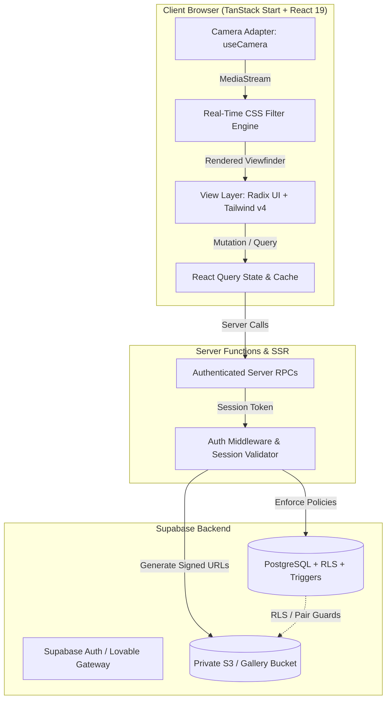

# System Architecture

Snap-it is an ephemeral photo-sharing platform built around privacy by design, lightweight client-side media manipulation, and database-enforced social boundaries.

This document describes how the platform's layers fit together, from the browser camera feed down to Postgres row-level security.



## 1. Core Design Tenets

1. **Zero Location Overhead:** We do not collect, store, or process GPS coordinates or IP-derived geographical points. User discovery runs strictly through opt-in interest tags (`user_tags`).
2. **Database-Level Authority:** Social rules (friendship transitions, story timeouts, blocking, point awards) are enforced in database triggers and functions, never entrusted to client logic.
3. **Private-by-Default Storage:** All captured photos are saved to a private `gallery` bucket under the owner's UID (`<uid>/<filename>`). Access requires short-lived, signed URLs issued only after verifying viewer authorization.
4. **Hardware-Decoupled Camera:** The browser camera integration lives strictly within `src/lib/camera` behind an adapter interface. This isolates hardware APIs so we can switch between web `MediaDevices` and future mobile native bridges without touching UI components.

## 2. Directory Layout & Layer Boundaries

```
src/
├── components/          # Application shell, social avatars, modals, widgets
│   └── ui/              # Headless Radix UI primitives styled with Tailwind v4
├── hooks/               # Generic client hooks (viewport, layout, mobile detection)
├── integrations/        # External services
│   ├── lovable/         # Lovable Cloud Auth client
│   └── supabase/        # Supabase client, session attacher, auth middleware
├── lib/
│   ├── camera/          # useCamera adapter, stream management, CSS filter presets
│   ├── profile.ts       # Profile fetchers and visibility-scoped RPCs
│   ├── social.ts        # Social feeds, stories, chats, React Query bindings
│   ├── social-rules.ts  # Friendship state machine & audience rule validators
│   └── utils.ts         # Class name joining (clsx, tailwind-merge)
├── routes/              # TanStack Start file-based routing tree
│   ├── __root.tsx       # Root layout, HTML skeleton, font imports
│   ├── auth.tsx         # Sign in and authentication gate
│   └── _authenticated/  # Protected layouts (feed, camera, friends, stories, chat)
└── test/                # Unit tests, integration tests, routing tests
```

## 3. Camera Pipeline (`src/lib/camera`)

The camera system uses a three-tier design:

1. **Hardware Driver (`useCamera.ts`):**
   - Requests camera access via `navigator.mediaDevices.getUserMedia`.
   - Handles facing-mode switching (`environment` vs `user`) with automatic fallback.
   - Monitors stream track state and cleans up tracks on component unmount to release camera hardware immediately.

2. **Real-Time Filter Pipeline (`filters.ts`):**
   - Applies hardware-accelerated CSS filter matrices (contrast, brightness, hue-rotate, sepia, invert, blur) directly to the video element.
   - Operates at 60 frames per second without touching GPU compute shaders or pulling raw frames through CPU memory.

3. **Frame Capture & Downsampling:**
   - On capture, paints the current video frame into an off-screen HTML5 `<canvas>`.
   - Bakes in the active CSS filter effects.
   - Compresses the output into a WebP blob before uploading to Supabase Storage.

## 4. Database Schema & Social Logic (`drizzle/` & `supabase/`)

### Tables

- `profiles`: User identity, handle, avatar path, display name, onboarded flag.
- `user_tags`: Interest tags linked to users. Only rows with `is_public = true` are exposed to strangers.
- `friendships`: Tracks directional and reciprocal friendship status (`pending`, `accepted`).
- `blocks`: Bidirectional blocking entries. When a block row is inserted, any active friendship is destroyed immediately.
- `stories`: Ephemeral photo posts. Rows automatically expire 24 hours after creation.
- `story_views`: Deduplicated record of which users have opened a story.
- `messages`: Ephemeral one-on-one direct messages.
- `media`: Metadata registry for photos uploaded to the private `gallery` bucket.
- `point_events`: Immutable audit ledger recording engagement points (daily story rewards, friend connections).

### Security Policies (RLS)

- **Pair Guards:** All social reads evaluate both sides of the relationship to guarantee neither party has blocked the other.
- **Owner Isolation:** Private user profiles and media rows can only be read directly by their owner. Public viewers must use the `visible_profile` RPC.
- **Signed URL Authorization:** Storage buckets disallow public reads. URLs expire after 60 seconds and are issued only after validating audience membership.

## 5. State Management & Data Fetching

We use `@tanstack/react-query` as the single source of truth for remote state:

- **Optimistic Updates:** Friend requests and messages update local query caches immediately, rolling back on error.
- **Realtime Invalidation:** Database change subscriptions trigger React Query cache invalidations, keeping friend lists and stories synchronized across browser tabs.
